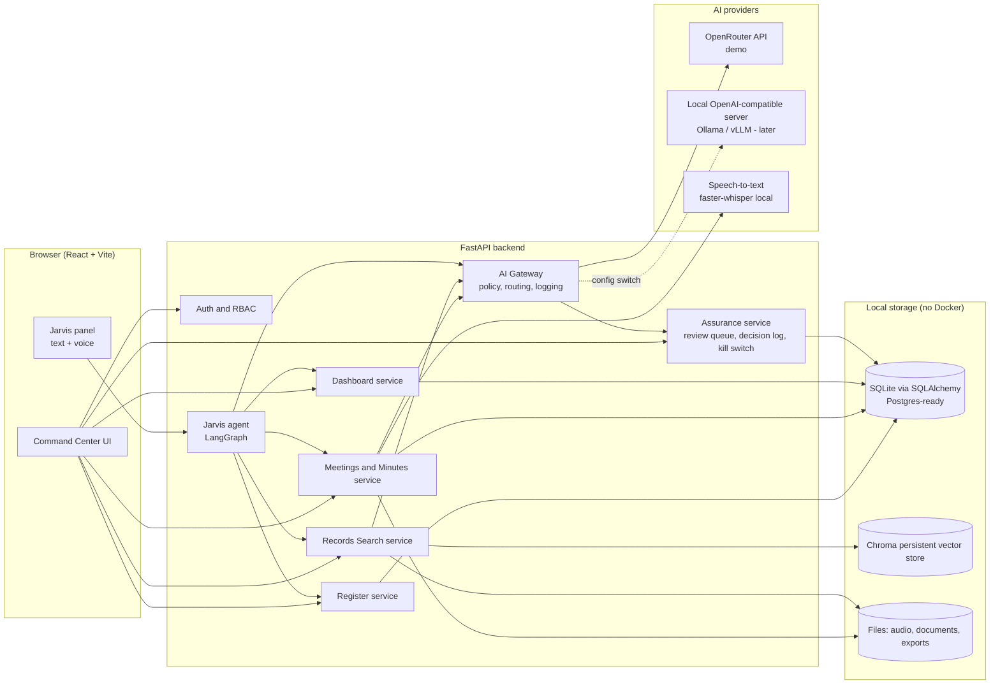
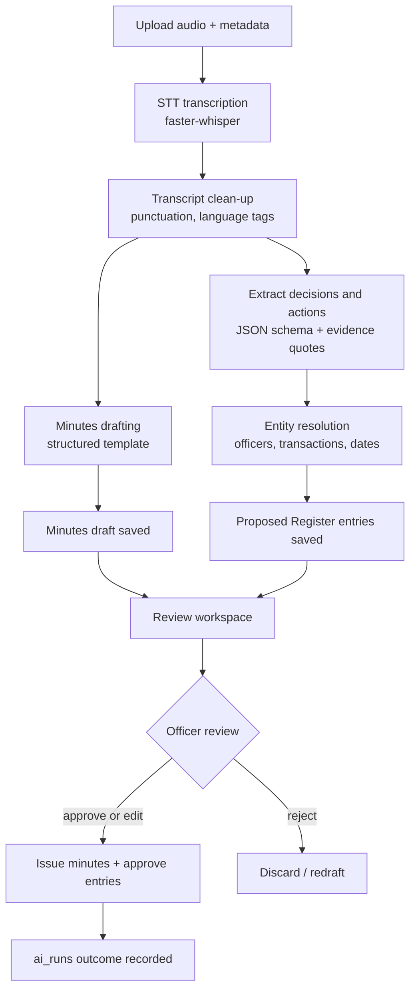

# PC Command Center — Architecture & Build Specification (Demo v1)

> Working product name: **PC Command Center**. Working name of the AI assistant: **Jarvis** (configurable in settings).
> Audience: Codex (or any coding agent) building the system, and the team reviewing it.
> Source: director's proposal deck for the Privatisation Commission (PC) Chairman's office ("the Minister").

---

## 0. How to use this document (instructions to the coding agent)

1. Read the whole document before writing code.
2. Build **phase by phase** (Section 16). Do not start a phase until the previous phase's acceptance criteria pass.
3. Do not invent features outside this spec. If something is ambiguous, choose the simplest option, record the choice in `docs/DECISIONS.md`, and continue.
4. All code must be complete and runnable: type hints, no placeholders, no `TODO` stubs left in finished phases.
5. **No Docker.** The demo runs with two processes (backend, frontend) started by simple scripts.
6. **All data in the demo is synthetic.** Never ask for or embed real confidential data.
7. Every AI-produced output goes through the human-review and logging rules in Section 9. This is the core selling point of the product, not an optional extra.
8. Each phase ends with: working code, tests, updated `README.md`, and a short entry in `docs/PROGRESS.md`.

---

## 1. Purpose and demo goals

### 1.1 What the product is
A secure office-intelligence platform for the Chairman's office of the Privatisation Commission. It keeps one authoritative record of every decision and instruction, turns meetings into minutes and tracked actions, gives the Minister a one-page Friday view of all 17 transactions, and answers questions from the office's own records through a conversational assistant.

### 1.2 What the demo must prove (in ~15 minutes)
1. **One Register** captures every decision, owner, deadline, priority and status, and flags overdue items.
2. **A meeting recording becomes minutes and proposed actions** in minutes, with a named officer approving before anything is official.
3. **The Friday dashboard** shows all 17 transactions, decisions due, overdue actions and engagements, and every number drills down to Register entries.
4. **Records Search** answers questions with citations to source documents.
5. **Jarvis**, a conversational and voice-capable assistant, ties it all together: the Minister can ask for status, a brief, or an overdue list, and Jarvis can propose actions (never commit them silently).
6. **AI assurance is visible**: human-in-the-loop approval, AI decision log, kill switch, two-zone data rule indicator.

### 1.3 Non-goals for the demo
Real authentication integrations (SSO), real transaction data, the full compliance workflow engine, Docker/Kubernetes, on-premise model hosting, mobile apps, multi-tenant support.

---

## 2. Design principles

- **Register is the spine.** Every other module reads from or writes (as proposals) to the Register.
- **Proposed, not committed.** AI never writes official records. It creates `proposed` items that a named human approves.
- **Provider-agnostic AI.** Demo uses OpenRouter; production uses local open-weight models. Switching must be a configuration change, not a code change (Section 8).
- **Policy in code, not in prompts.** Data-classification rules are enforced by the AI gateway, not by asking the model to behave.
- **Everything traceable.** Every record shows who created it, when, from what source, and whether AI assisted.
- **Professional by default.** Calm, dense-but-readable, government-grade UI (Section 12).

---

## 3. System overview



---

## 4. Technology stack

### 4.1 Backend (Python 3.11+)
| Concern | Choice |
|---|---|
| Web framework | FastAPI + Uvicorn |
| Validation / settings | Pydantic v2, pydantic-settings |
| ORM / migrations | SQLAlchemy 2.x, Alembic (SQLite for demo, schema must be Postgres-compatible) |
| Auth | JWT (access token), password hashing with `passlib[bcrypt]`, role-based access control |
| LLM client | `openai` Python SDK pointed at an OpenAI-compatible base URL (OpenRouter now, local server later) |
| Agent orchestration | LangGraph (Minutes pipeline, Jarvis agent); LangChain only for message/tool primitives if needed |
| Retrieval | ChromaDB (persistent, local) + `rank_bm25` for hybrid search |
| Embeddings | Local multilingual sentence-transformers model (configurable; must handle Urdu and English). Optional OpenRouter embeddings behind the same interface |
| Speech-to-text | `faster-whisper` (local) behind an `STTProvider` interface |
| Document parsing | `pypdf`, `python-docx`, plain text/markdown |
| Exports | `python-docx` for minutes (.docx); frontend print stylesheet for Friday report PDF |
| Background jobs | FastAPI `BackgroundTasks` plus a `jobs` table for status (no Redis/Celery) |
| Streaming | Server-Sent Events (SSE) for Jarvis and long-running jobs |
| Testing | pytest, httpx, pytest-asyncio |
| Quality | ruff, mypy (strict on `app/`) |

### 4.2 Frontend
| Concern | Choice |
|---|---|
| Framework | React 18 + Vite + TypeScript (strict) |
| Styling | Tailwind CSS + shadcn/ui (Radix) |
| Data fetching | TanStack Query; typed API client generated from the FastAPI OpenAPI schema |
| Tables | TanStack Table |
| Charts | Recharts |
| Motion | Framer Motion (subtle only) |
| Icons | lucide-react |
| Command palette | cmdk (Ctrl/Cmd+K) |
| Audio waveform | wavesurfer.js |
| Routing | React Router |
| i18n / RTL | i18next with `en` and `ur`; RTL support for Urdu content |
| Fonts | Inter (UI), Noto Nastaliq Urdu (Urdu content), JetBrains Mono (IDs/serials) |

### 4.3 Running without Docker
- `backend/`: `python -m venv .venv`, install from `requirements.txt`, run `uvicorn app.main:app --reload`.
- `frontend/`: `npm install`, `npm run dev`.
- Provide `scripts/dev` helpers (`run_backend`, `run_frontend`, `seed`) for both Windows (PowerShell) and Unix shells.
- All paths, keys and model names come from `.env` (Section 14).

---

## 5. Repository structure

```
pc-command-center/
├── README.md
├── ARCHITECTURE.md
├── docs/
│   ├── DECISIONS.md
│   ├── PROGRESS.md
│   └── DEMO_SCRIPT.md
├── scripts/                      # run/seed helpers (ps1 + sh)
├── backend/
│   ├── requirements.txt
│   ├── alembic/
│   ├── app/
│   │   ├── main.py
│   │   ├── core/                 # config, security, deps, logging, errors
│   │   ├── db/                   # session, base, models/, seed/
│   │   ├── schemas/              # pydantic request/response models
│   │   ├── api/v1/               # routers: auth, register, meetings, minutes,
│   │   │                         # transactions, dashboard, search, documents,
│   │   │                         # assurance, jarvis, compliance, engagements, admin
│   │   ├── services/             # business logic per module
│   │   ├── ai/
│   │   │   ├── gateway.py        # AIGateway: policy, routing, logging, retries
│   │   │   ├── providers/        # openrouter.py, local.py, base.py
│   │   │   ├── stt/              # base.py, faster_whisper.py
│   │   │   ├── embeddings/       # base.py, local.py
│   │   │   ├── prompts/          # versioned prompt templates (.md/.jinja)
│   │   │   ├── schemas/          # structured-output Pydantic models
│   │   │   ├── agents/           # minutes_graph.py, jarvis_graph.py, tools/
│   │   │   └── rag/              # ingest.py, chunking.py, retriever.py, answer.py
│   │   └── tests/
├── frontend/
│   ├── package.json
│   └── src/
│       ├── app/                  # routes, layout, providers
│       ├── components/           # ui/ (shadcn), shared/, jarvis/, charts/
│       ├── features/             # register, meetings, dashboard, search,
│       │                         # transactions, assurance, compliance, admin
│       ├── lib/                  # api client, auth, i18n, utils
│       └── styles/               # tokens.css, globals
└── data/                         # created at runtime (gitignored)
    ├── app.db
    ├── chroma/
    ├── audio/
    ├── documents/
    └── exports/
```

---

## 6. Roles and access control

Use role-based personas, not real names. The demo seeds one user per role.

| Role | Maps to (deck) | Can do |
|---|---|---|
| `minister` | The Minister | Read-only view of dashboard, Register, minutes, search; use Jarvis (read + propose) |
| `cos` | Director Staff (single door) | Full Register ownership, approve/issue minutes, approve AI proposals, kill switch, assurance |
| `director_td` | Director (Transformation & Delivery) | Meetings, minutes drafting, engagements, records, AI tools, kill switch |
| `liaison` | Liaison, Advisory & HR Lead | Transaction status notes, briefs, read Register |
| `legal` | Legal Vetting Desk | Compliance calendar, document vetting, read Register |
| `analyst` | Dashboard Analyst | Dashboards, spot-checks, assurance reports |
| `data_coordinator` | AI Data Coordinator | Documents, classification, data quality, ingestion |
| `admin` | System admin | Users, settings, provider config |

Rules:
- Every endpoint declares required roles via a dependency; deny by default.
- Document and chunk visibility is filtered by classification and role (Section 9.4).
- Every state-changing request writes an `audit_events` row.

---

## 7. Data model

All tables have `id` (UUID), `created_at`, `updated_at`. Use enums stored as strings. Soft-delete is not used for Register entries; changes are tracked through `audit_events`.

### 7.1 Core entities

**users**: `name`, `email`, `password_hash`, `role`, `designation`, `active`.

**transactions** (the 17 privatisation transactions):
`code` (e.g. "TX-A"), `name`, `sector`, `stage` (enum below), `next_milestone`, `next_milestone_date`, `health` (`on_track | at_risk | delayed`), `lead_user_id`, `summary`, `updated_by`.
Stage enum: `approval_inclusion`, `adviser_hiring`, `due_diligence`, `eoi_prequalification`, `bidding`, `approvals`, `closing`.
(Stage names are generic per the deck and must live in one config list so they can be replaced with the Commission's real stages.)

**transaction_events**: `transaction_id`, `occurred_at`, `event_type` (stage_change, milestone, note, risk), `description`, `source_ref`.

**register_entries** (the Decision & Action Register):

| Field | Notes |
|---|---|
| `serial_no` | Sequential, restarted each financial year (`fy` column, unique with serial) |
| `fy` | Financial year, e.g. "2026-27" |
| `occurred_at` | Date and time of meeting or instruction |
| `occasion_type` | `meeting | engagement | file | on_the_move` |
| `occasion_ref` | Free text or FK to meeting/engagement |
| `description` | What was decided or instructed |
| `minister_words` | Optional verbatim words |
| `officer_id` | **One user**, never a unit |
| `deadline` | Date (required; the UI must reject "urgent") |
| `priority` | `A` (24h), `B` (3 working days), `C` (information) |
| `source_record` | Minute id, instruction slip, or file number |
| `status` | `open | in_progress | closed | closed_with_note` |
| `closed_at`, `closure_note` | Set when closed |
| `overdue` | Computed (deadline passed and not closed); also materialised nightly/on read for the Friday report |
| `transaction_id` | Optional link |
| `origin` | `manual | ai_proposed` |
| `review_state` | `approved | proposed | rejected` (manual entries are `approved`) |
| `ai_assistance` | JSON: `{tool, model, run_id, checked_by, checked_at}` or null |

Rules: only `approved` entries count in dashboards, KPIs and reports. Serial numbers are assigned at approval time, not at proposal time.

**meetings**: `title`, `occurred_at`, `occasion_type`, `location`, `attendees` (JSON), `audio_path`, `language_hint`, `status` (`uploaded | transcribing | transcribed | drafting | draft_ready | under_review | issued`), `draft_due_at` (+24h), `issue_due_at` (+48h).

**transcripts**: `meeting_id`, `language`, `segments` (JSON: `start`, `end`, `text`, `lang`, optional `speaker`), `stt_provider`, `stt_model`.

**minutes**: `meeting_id`, `version`, `body_markdown`, `status` (`draft | under_review | issued`), `drafted_by_run_id`, `reviewed_by`, `issued_at`, `export_path`.

**proposed_actions** are stored as `register_entries` with `review_state = proposed` plus an `evidence` JSON on the entry: `{meeting_id, transcript_start, transcript_end, quote, confidence}`.

**documents**: `title`, `doc_type` (`board_paper | cabinet_paper | ccop | wing_paper | minute | brief | other`), `classification` (`public | internal | confidential`), `transaction_id`, `file_path`, `text_extracted`, `source_note`, `is_synthetic` (bool, true in demo), `ingest_status`.

**document_chunks**: `document_id`, `chunk_index`, `text`, `page`, `section`, `char_start`, `char_end`, `vector_id` (Chroma id). Chunk text is duplicated in SQL for BM25 and citations.

**engagements**: `title`, `engagement_type`, `starts_at`, `location`, `pack_status` (`not_started | in_progress | ready`), `pack_due_at` (-48h), `owner_id`, `transaction_id`.

**minister_decisions** (decisions the Minister owes): `title`, `due_date`, `transaction_id`, `status`, `context_ref`.

**compliance_items**: `category` (statutory, cabinet_ccop, board, audit, courts, transaction_milestone, integrity, rti), `title`, `due_date`, `owner_id`, `status`, `reference`.

### 7.2 Assurance entities

**ai_runs** (the AI decision log, one row per AI-assisted product):
`tool` (minutes_assistant, records_search, jarvis, brief_builder, ...), `provider`, `model`, `zone` (`cloud | local`), `data_classification_max`, `input_refs` (JSON), `output_ref`, `prompt_version`, `tokens_in`, `tokens_out`, `latency_ms`, `cost_estimate`, `outcome` (`pending_review | approved | edited | rejected | not_applicable`), `reviewed_by`, `reviewed_at`, `changes_summary`, `error`.

**tool_switches**: `tool` (unique), `enabled`, `suspended_by`, `suspended_at`, `reason`. A suspended tool must fail closed: every service checks the switch before invoking AI.

**spot_checks**: `period`, `sample` (JSON of run ids), `reconciled_by`, `findings`, `status`.

**audit_events** (append-only): `actor_id`, `action`, `entity_type`, `entity_id`, `before` (JSON), `after` (JSON), `ip`, `at`. No update or delete endpoints exist for this table.

### 7.3 Assistant entities
**chat_sessions** (`user_id`, `title`), **chat_messages** (`session_id`, `role`, `content`, `tool_calls` JSON, `citations` JSON, `run_id`).

---

## 8. The AI Gateway (provider abstraction and policy)

All model calls in the system go through `AIGateway`. No module calls OpenRouter, Ollama or any model API directly.

### 8.1 Responsibilities
1. **Routing by model role**, not model name. Roles: `chat` (Jarvis, general), `reasoning` (briefs, hard analysis), `extraction` (structured JSON), `fast` (classification, rewriting), `embedding`. Each role maps to a provider and model id via environment config.
2. **Provider interface**: `chat(messages, tools=None, response_format=None, stream=False)`, `embed(texts)`. Implementations: `OpenRouterProvider` (OpenAI-compatible, base URL `https://openrouter.ai/api/v1`), `LocalProvider` (any OpenAI-compatible server such as Ollama or vLLM; same code, different base URL). Each provider declares `zone = "cloud" | "local"`.
3. **Policy enforcement (two-zone rule)**: every call carries `classification` of the data in the prompt. If `classification` is `confidential` and the provider zone is `cloud`, raise `PolicyViolation` and log it. In the demo, documents are flagged `is_synthetic`; an explicit setting `ALLOW_CLOUD_FOR_SYNTHETIC_DEMO=true` permits cloud calls for synthetic data only. The UI must show the active zone on every AI-assisted screen.
4. **Kill switch check**: before any call, verify `tool_switches` for the calling tool; if suspended, raise `ToolSuspended`.
5. **Structured output**: for extraction, request JSON, validate against a Pydantic schema, and on failure retry once with a repair prompt; otherwise mark the run `error` and surface a clear message.
6. **Logging**: create/complete an `ai_runs` row for every call (tokens, latency, model, zone, prompt version). Log metadata only; do not log full prompts containing document text unless `LOG_PROMPTS=true`.
7. **Resilience**: timeouts, bounded retries with backoff on 429/5xx, and a configurable fallback model per role.
8. **Prompt registry**: prompts live in `ai/prompts/` as versioned files; the version is stored on `ai_runs`.

### 8.2 Model selection
Do not hard-code model ids. Set them in `.env` per role and verify the ids against OpenRouter's current catalogue when building. Requirements by role: `chat` needs reliable tool calling and streaming; `extraction` needs reliable JSON output and good Urdu/English handling; `reasoning` can be slower and stronger; `fast` should be cheap.

### 8.3 Speech-to-text
`STTProvider.transcribe(audio_path, language_hint) -> segments[]`. Default: `faster-whisper` running locally (model size from `.env`; supports Urdu and English; word/segment timestamps). If an audio-capable model is later confirmed available on the chosen provider, add it as a second implementation behind the same interface. Normalise audio with ffmpeg if available; document that requirement in the README.

---

## 9. AI assurance (build as visible product features)

### 9.1 Human in the loop
- AI outputs enter the system as `proposed` / `draft` / `under_review`.
- A named officer approves, edits and approves, or rejects. The approver's identity and timestamp are saved on the record and on the `ai_runs` row.
- Nothing is issued (minutes) or counted (Register, dashboard) until approved.

### 9.2 AI decision log
UI screen listing `ai_runs`: tool, model, zone, who checked, outcome, what changed (diff summary between AI output and approved version), timestamp. Filter by tool, date, outcome. Export to CSV.

### 9.3 Kill switch
Assurance screen with one switch per tool. Available to `cos` and `director_td`. Suspending writes an audit event and a Register-style log entry the same day, shows a prominent banner on affected screens, and makes backend calls fail closed with a clear message.

### 9.4 Two-zone data rule
- Documents carry `classification`.
- Retrieval filters chunks by the user's clearance (`minister`/`cos` see all; others limited by role).
- Gateway policy (Section 8.1.3) blocks confidential data from reaching cloud providers.
- A persistent badge in the app shell shows: `Zone: Cloud (synthetic demo data)` or `Zone: Local (confidential permitted)`.

### 9.5 Accuracy spot-checks
`analyst` can generate a monthly sample (random N approved AI-assisted products), compare against source, and record findings. Provide a simple reconciliation view; keep it small.

### 9.6 Quarterly assurance note (stretch)
A button that drafts a short note (accuracy, usage, incidents) from `ai_runs` and `spot_checks`, saved as a draft for review.

---

## 10. Modules

### 10.1 Decision & Action Register
**Backend**
- CRUD with validation: deadline must be a real date; officer must be one user; priority derives a suggested deadline (A: +24h, B: +3 working days) but can be overridden.
- Serial assignment per financial year at approval time, concurrency-safe.
- Status transitions validated (`open → in_progress → closed | closed_with_note`).
- Overdue computed on read; `GET /register/overdue` returns grouped by officer.
- Full-text filter, saved filters, CSV export.

**Frontend**
- Dense, sortable, filterable table (status, priority, officer, transaction, overdue, date range, origin).
- Row opens a right-side detail drawer: all fields, source link, AI-assistance badge, audit history timeline.
- Inline quick actions: change status, reassign (with reason), close with note.
- Overdue rows have a clear but restrained visual flag.

### 10.2 Meetings and Minutes Assistant

**Flow (LangGraph `minutes_graph`)**



**Structured extraction schema** (per action): `description`, `officer_hint` (name or role as spoken), `deadline_hint` (text) and `deadline_date` (resolved or null), `priority_suggestion`, `transaction_hint`, `quote`, `transcript_start`, `transcript_end`, `confidence` (0-1). Items with unresolved officer or deadline are still proposed but flagged "needs input" and cannot be approved until completed.

**Minutes template**: header (meeting, date, place, attendees), agenda/topics, discussion summary, decisions, action table (owner, deadline, priority), next meeting. English output; keep Urdu quotes verbatim where relevant.

**Review workspace (key demo screen)**: three panes: (1) audio player with waveform and clickable transcript, (2) minutes editor, (3) extracted actions list. Clicking an action highlights its evidence in the transcript and jumps the audio to that moment. Approve/Reject per action; "Issue minutes" disabled until all actions are resolved. Show the 24h draft / 48h issue timers.

**Export**: issued minutes as `.docx` and PDF-friendly print view.

### 10.3 Minister's Delivery Dashboard (Friday view)
Single page matching the deck's layout, but computed live from the database.

- KPI tiles: transactions in process (17), decisions due this week, actions overdue, engagements this week.
- Transactions by stage (bar chart; stage list from config).
- Next-milestones table: transaction, stage, next milestone, health.
- Decisions due from the Minister (with dates).
- Overdue actions with owner.
- Upcoming engagements with pack readiness.
- "Data comes from" footer with last-refreshed timestamp.
- **Drill-down**: every number and row is clickable and opens the underlying Register entries/records (reconciliation to the Register is a headline feature).
- "Week ending" selector; a "Print / Save as PDF" mode with a clean print stylesheet.
- Optional AI summary strip: "This week in 5 lines" generated by Jarvis, labelled as AI-generated and reviewed-by field.

Backend: one aggregate endpoint plus drill-down endpoints; all counts derived from `approved` entries only.

### 10.4 Records Search (RAG)
**Ingestion** (`data_coordinator` or `cos`): upload PDF/DOCX/TXT/MD with `doc_type`, `classification`, `transaction`. Pipeline: extract text (keep page numbers) → chunk (semantic-ish, ~500-800 tokens, overlap ~80, keep section headings) → embed → store in Chroma with metadata (document id, classification, transaction, page, doc type) → store chunk text in SQL.

**Retrieval**: hybrid (vector + BM25), top-k merge with reciprocal rank fusion, filtered by the user's clearance and optional filters (transaction, doc type, date). Optional lightweight reranking via the `fast` model role.

**Answering**: answer only from retrieved context; every claim gets a numbered citation `[n]` that maps to document, page/section and a text snippet. If evidence is insufficient, say so plainly. Also search structured Register entries and minutes (index them as documents of type `minute` / `register`).

**UI**: search page with answer on the left, citation list/source viewer on the right, filters on top, "ask a follow-up". Clicking a citation opens the source document at the chunk.

### 10.5 Jarvis (conversational assistant)
This is the "wow" layer. It must feel like a capable chief-of-staff assistant, not a chatbot.

**Capabilities**
- Natural-language Q&A over the Register, dashboard data, transactions, minutes and documents.
- Proactive "Daily Brief" (the deck's morning brief at 0900): what's overdue, decisions due, today's engagements, risks. Generated on demand and on first login of the day.
- Draft assistance: summary of a transaction, a short meeting brief, a draft reply (marked as AI draft).
- **Propose actions**: e.g. "Create an action for the CoS to chase the adviser contract by Wednesday" creates a `proposed` Register entry and shows a confirmation card (Approve / Edit / Dismiss). Jarvis never commits silently.
- Voice: push-to-talk microphone button sends audio to `/jarvis/stt` (same STT provider), then runs the normal text flow; optional spoken reply using the browser's `speechSynthesis`. Support English and Urdu input.
- Context aware: knows the current page/entity (for example, viewing Transaction C → "what's the next milestone?").

**Agent design (LangGraph tool-calling agent)**
Tools (all read-only unless noted; each tool enforces the calling user's role):
- `get_dashboard_summary(week)`
- `query_register(filters)` and `get_register_entry(id)`
- `list_overdue(owner?)`
- `get_transaction(code)` and `list_transactions(filters)`
- `get_upcoming_engagements(range)`
- `search_records(query, filters)` (RAG with citations)
- `get_minutes(meeting_id)`
- `get_compliance_due(range)`
- `propose_register_entry(...)` (**write: creates `proposed` only**)

Behaviour rules (system prompt, versioned):
- Ground every factual statement in tool results; cite Register serials or document citations.
- If data is missing or tools fail, say so; never invent figures.
- Never present AI output as a decision of the office.
- Refuse or redirect requests outside the office's records.
- Short, executive tone by default; offer detail on request.
- Respect the kill switch and role permissions.

**Streaming UX**: SSE stream of tokens plus structured events (`tool_start`, `tool_result`, `citation`, `proposal_card`). The UI shows a subtle "Checking the Register…" activity line so the Minister sees it working.

**Quick prompts** on the empty state: "Brief me for today", "What is overdue?", "Status of Transaction C", "What did we decide on the adviser contract?".

### 10.6 Transactions
List and detail views for the 17 transactions: stage pipeline visual, health, next milestone, event timeline, linked Register entries, documents, and meetings. Edits allowed to `liaison` and `cos`; each edit logged.

### 10.7 Compliance calendar (light)
Calendar/list of dated items by category with owner and status; "falling due in the next fortnight" panel (used by the Friday view). CRUD for `legal` and `cos`. No workflow engine.

### 10.8 Engagements (light)
List with pack readiness (48-hour rule highlighted when at risk) feeding the dashboard.

### 10.9 Brief Builder and Parliamentary Q&A (stretch, only after Phase 8)
Both reuse Records Search and the Gateway. Brief Builder: pick a meeting/transaction → structured one-page brief with citations. Parliamentary Q&A: paste a question → draft answer with citations, always marked `draft - requires review`. Keep each to a single screen and a single agent graph.

---

## 11. API surface (REST, prefix `/api/v1`)

| Area | Endpoints (summary) |
|---|---|
| Auth | `POST /auth/login`, `GET /auth/me` |
| Register | `GET/POST /register`, `GET/PATCH /register/{id}`, `POST /register/{id}/approve`, `POST /register/{id}/reject`, `GET /register/overdue`, `GET /register/export.csv` |
| Meetings | `POST /meetings` (metadata), `POST /meetings/{id}/audio`, `POST /meetings/{id}/process`, `GET /meetings`, `GET /meetings/{id}`, `GET /meetings/{id}/transcript` |
| Minutes | `GET/PUT /minutes/{id}`, `POST /minutes/{id}/issue`, `GET /minutes/{id}/export.docx` |
| Jobs | `GET /jobs/{id}`, SSE `GET /jobs/{id}/events` |
| Dashboard | `GET /dashboard?week_ending=`, drill-downs: `GET /dashboard/drill/{kpi}` |
| Transactions | `GET /transactions`, `GET /transactions/{code}`, `PATCH ...`, `POST /transactions/{code}/events` |
| Documents | `POST /documents`, `GET /documents`, `GET /documents/{id}`, `DELETE /documents/{id}` (admin) |
| Search | `POST /search` (query, filters) returning answer + citations |
| Jarvis | `POST /jarvis/sessions`, `POST /jarvis/sessions/{id}/messages` (SSE), `POST /jarvis/stt`, `GET /jarvis/daily-brief` |
| Assurance | `GET /assurance/runs`, `POST /assurance/runs/{id}/review`, `GET/PUT /assurance/switches/{tool}`, `POST/GET /assurance/spot-checks`, `GET /assurance/runs/export.csv` |
| Compliance / Engagements | standard CRUD |
| Admin | users CRUD, `GET/PUT /admin/settings` (zone mode, model roles display; secrets never returned) |
| Health | `GET /health`, `GET /health/ai` (provider reachability, STT ready, vector store ready) |

Conventions: JSON, ISO 8601 UTC timestamps, consistent error envelope `{error: {code, message, details}}`, pagination `limit/offset` with total, OpenAPI docs enabled.

---

## 12. UI / UX design system

**Direction**: a calm, authoritative "command center" for a senior government office. Dense information, generous whitespace around it, no gimmicks. Dark navy shell with a light content canvas by default; full dark mode as an option.

### 12.1 Tokens (put in `tokens.css`, mapped into Tailwind)
- **Ink / shell**: `#0B1F3A` (navy), `#12294B` (raised), `#1B3A66` (hover).
- **Canvas**: `#F5F7FA`; surfaces `#FFFFFF`; borders `#E2E8F0`.
- **Text**: primary `#0F172A`, secondary `#475569`, on-dark `#E6EDF7`.
- **Accent (brand)**: `#C9A227` (restrained gold) for highlights and focus accents; secondary accent teal `#0E7C86` for interactive elements.
- **Status**: on track `#16A34A`, at risk `#D97706`, delayed/overdue `#DC2626`, info `#2563EB`, AI-generated `#6D28D9` (purple, used only to mark AI content).
- Radius 10px on cards, 8px on controls; shadows very soft; 8px spacing grid.
- Typography: Inter; scale 12/14/16/20/28/36; tabular numbers for all figures; Noto Nastaliq Urdu for Urdu text with increased line height.

### 12.2 App shell
- Left rail: Command Center, Register, Review Queue (with badge count), Meetings and Minutes, Transactions, Records Search, Compliance, Engagements, AI Assurance, Admin (role-gated).
- Top bar: global search/command palette (Ctrl/Cmd+K), **zone badge**, tool-status indicator (green/amber if any tool suspended), notifications, user menu, language toggle (EN/اردو with RTL).
- Right-side **Jarvis dock**: collapsible panel available on every screen; expands to full-page mode. Subtle animated orb/waveform while listening or thinking (restrained, not sci-fi).

### 12.3 Key patterns
- **AI marking**: any AI-generated content carries a small purple "AI draft" chip until approved, then shows "Reviewed by <name>, <date>".
- **Status chips** with consistent colours; overdue is always paired with an icon and text, not colour alone.
- **Drawers over modals** for record detail; modals only for confirmations.
- **Empty, loading (skeletons), and error states** designed for every screen.
- **Toasts** for confirmations; undo where safe.
- **Keyboard**: full keyboard navigation in tables; documented shortcuts.
- **Print**: Friday dashboard and issued minutes have print stylesheets (A4, header with office name, footer with generated timestamp).
- **Accessibility**: WCAG AA contrast, focus rings, ARIA on charts (data tables as fallback), RTL-correct layouts.

### 12.4 Screens to deliver
1. Login
2. **Command Center** (Friday dashboard + Daily Brief + Jarvis dock)
3. Register (table + drawer)
4. Review Queue (all pending AI proposals across modules)
5. Meetings list and **Minutes Review Workspace**
6. Transactions list and detail
7. Records Search (with source viewer) and Document library/ingestion
8. Compliance calendar
9. Engagements
10. AI Assurance (decision log, kill switches, spot-checks)
11. Admin (users, settings, system health)

---

## 13. Seed data (all synthetic, deterministic)

Provide `python -m app.db.seed` that creates a realistic, story-driven dataset. Never reuse real names; use role personas with plausible fictional names.

- **Users**: one per role (Section 6), shared demo password documented in README for demo only.
- **Transactions**: exactly 17, distributed across stages to match the deck's sample: approval/inclusion 2, adviser hiring 3, due diligence 3, EOI/pre-qualification 3, bidding 2, approvals 2, closing 2. Generic names (e.g. "Power Distribution Company A", "Airline B", "Hotel C"). Include a story: one `at_risk` in bidding, one `delayed` in adviser hiring, the rest mostly on track.
- **Register**: 50-70 approved entries across the past ~8 weeks, mix of priorities and statuses, ~6 overdue (spread across 3 officers), 5-8 due this week, linked to transactions. Plus 6-8 `proposed` AI entries awaiting review so the Review Queue is never empty.
- **Meetings**: 6 past meetings with issued minutes; 1-2 meetings with audio ready to process live in the demo.
- **Documents**: 12-15 synthetic PDFs/DOCX (board paper, CCoP summary, adviser contract note, wing papers, a draft parliamentary question), mixed classifications, all `is_synthetic = true`.
- **Minister decisions**: 3-4 due this week (matching the deck: a CCoP summary, an adviser contract, a reply to a Standing Committee).
- **Engagements**: 5-6 this week/next, with mixed pack readiness.
- **Compliance items**: 15-20 across categories.
- **Audio**: README must instruct the team to record two short sample meetings (one English, one Urdu/mixed) per a provided script (`docs/DEMO_SCRIPT.md` includes the scripts and the expected extracted actions).

---

## 14. Configuration (`.env`)

```
APP_ENV=demo
SECRET_KEY=change-me
DATABASE_URL=sqlite:///./data/app.db
DATA_DIR=./data

# AI gateway
AI_ZONE_MODE=cloud                   # cloud | local
ALLOW_CLOUD_FOR_SYNTHETIC_DEMO=true
OPENROUTER_API_KEY=
OPENROUTER_BASE_URL=https://openrouter.ai/api/v1
LOCAL_LLM_BASE_URL=http://localhost:11434/v1
MODEL_CHAT=
MODEL_REASONING=
MODEL_EXTRACTION=
MODEL_FAST=
MODEL_FALLBACK=
LOG_PROMPTS=false

# Speech and embeddings
STT_PROVIDER=faster_whisper
STT_MODEL_SIZE=small
EMBEDDING_PROVIDER=local
EMBEDDING_MODEL=
CORS_ORIGINS=http://localhost:5173
```

Secrets are never returned by any API and never committed. Provide `.env.example`.

---

## 15. Cross-cutting requirements

- **Security**: password hashing, short-lived JWTs, CORS allow-list, upload limits and type checks, path-traversal protection, rate limiting on auth and AI endpoints, no secrets in logs.
- **Observability**: structured logging with request ids; `/health/ai` surfaces provider/STT/vector readiness for the demo host to check before presenting.
- **Performance targets (demo)**: dashboard < 1 s; Register page < 500 ms for 1,000 rows; Jarvis first token < 3 s; a 5-minute meeting processed in a few minutes with live progress.
- **Resilience for presentations**: every AI feature has a clear failure message and a way to retry; include a **"Demo mode" cache** option that stores the last successful AI result for seeded sample meetings so the demo can run if the network drops (clearly labelled in code and docs as a demo safeguard, off by default).
- **Testing**: unit tests for services (serial numbering, overdue, status transitions, RBAC), policy tests for the gateway (confidential + cloud must be blocked, kill switch fails closed), contract tests for structured-output schemas using recorded model responses, API tests for each router, and a Playwright smoke test of the main demo path (stretch).

---

## 16. Build phases and acceptance criteria

**Phase 0 — Foundation**
Repo, config, DB session, Alembic, auth, RBAC, audit events, health endpoints, frontend shell with design tokens, routing, login, app layout (rail, top bar, zone badge).
*Accept*: login as each role; protected routes work; `GET /health` OK; shell matches Section 12.

**Phase 1 — Register**
Models, services, API, seed users and Register data, table UI + drawer, filters, status transitions, CSV export, overdue logic.
*Accept*: serial numbers sequential per FY; deadline validation; only `approved` entries counted; audit history visible per entry.

**Phase 2 — Transactions and Dashboard**
Transactions CRUD, minister decisions, engagements, aggregate dashboard API with drill-downs, Friday dashboard UI and print view.
*Accept*: dashboard shows 17 transactions across the specified stage distribution; every KPI drills down to the exact underlying records; totals reconcile to the Register.

**Phase 3 — AI Gateway and Assurance core**
Provider interface, OpenRouter provider, local provider (config-only), role-based model routing, policy enforcement, kill switch, `ai_runs` logging, decision log UI, Review Queue UI.
*Accept*: confidential + cloud is blocked in tests; suspending a tool makes calls fail closed and shows banners; every AI call produces an `ai_runs` row; switching `AI_ZONE_MODE` requires no code change.

**Phase 4 — Minutes Assistant**
STT provider, LangGraph minutes pipeline, structured extraction, proposed entries, review workspace (audio + transcript + editor + actions), issue and `.docx` export, SLA timers.
*Accept*: seeded English sample yields minutes and the expected actions; evidence quotes link to transcript time; "Issue" blocked until all actions resolved; approved entries receive serials and appear on the dashboard.

**Phase 5 — Records Search**
Ingestion, chunking, embeddings, hybrid retrieval, clearance filtering, cited answers, document library, source viewer.
*Accept*: answers carry correct citations; unanswerable questions are declined; a user without clearance cannot retrieve confidential chunks.

**Phase 6 — Jarvis**
Agent with tools, SSE streaming, citations and proposal cards, daily brief, context awareness, voice input (push-to-talk), optional spoken replies, dock UI.
*Accept*: the scripted questions in `docs/DEMO_SCRIPT.md` produce grounded answers with citations; "create an action…" yields a proposed entry only; suspended Jarvis refuses gracefully.

**Phase 7 — Compliance, Engagements, Spot-checks, Admin polish**
Light modules, spot-check workflow, system health page.
*Accept*: fortnight-ahead panel works; spot-check records saved; admin can manage users.

**Phase 8 — Demo hardening**
Seed polish, demo-mode cache, empty/error states, performance pass, accessibility pass, README with exact run steps, `DEMO_SCRIPT.md` (15-minute run-of-show), rehearsal checklist.
*Accept*: clean machine setup from README in under 20 minutes; the full demo path runs end to end three times in a row.

**Phase 9 — Stretch** (only if time allows): Brief Builder, Parliamentary Q&A, quarterly assurance note, Playwright smoke test.

---

## 17. Path from demo to production (design now, do later)

- Swap provider via config to a local OpenAI-compatible server on encrypted office machines; keep the policy layer unchanged.
- Replace SQLite with PostgreSQL (SQLAlchemy models already compatible).
- Move audio/documents to encrypted storage; add disk encryption and backup policy.
- Replace demo auth with the Commission's identity system.
- Replace the generic stage list with the Commission's real transaction stages.
- Add Dockerized or service-based deployment only when the Commission's IT (CIO) specifies the environment.

---

## 18. Definition of done for the demo

- All acceptance criteria in Section 16 (Phases 0-8) pass.
- No real data anywhere; synthetic flag visible in the UI.
- Every AI feature is visibly reviewed, logged and suspendable.
- The 15-minute demo script runs without manual database edits.
- The UI passes a "would the Minister be comfortable showing this to the PM Office" review: no placeholder text, no console errors, consistent design tokens, print views clean.
